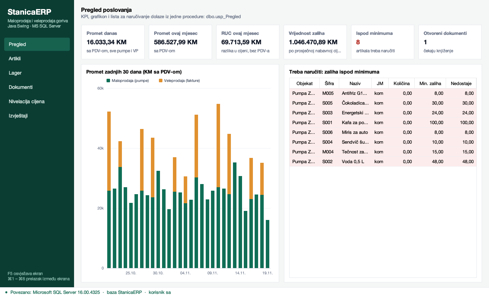
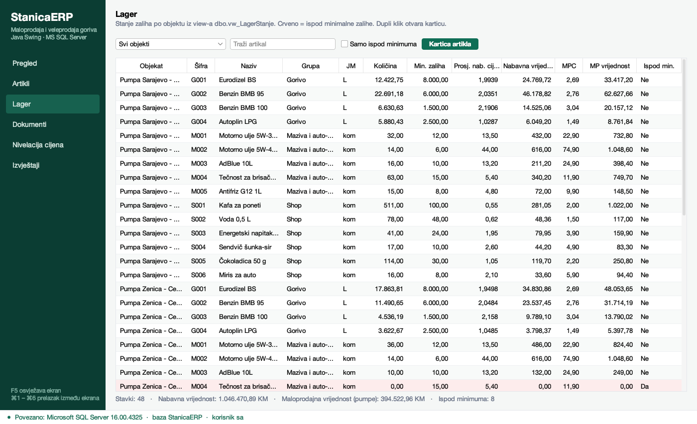
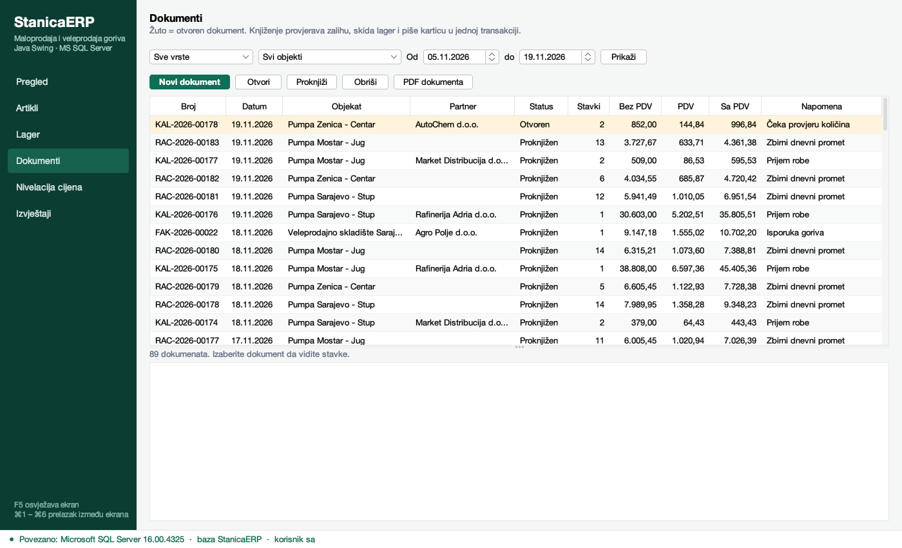
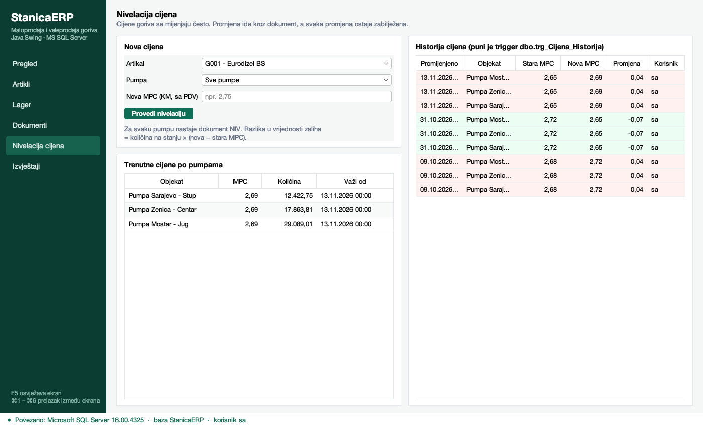
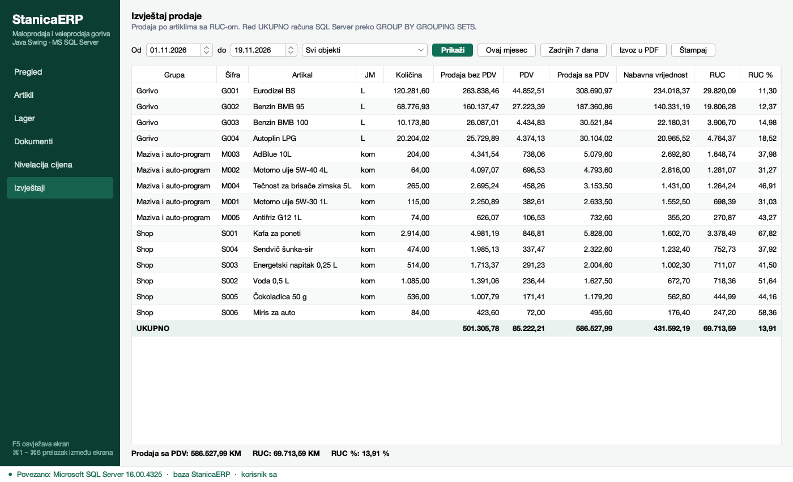
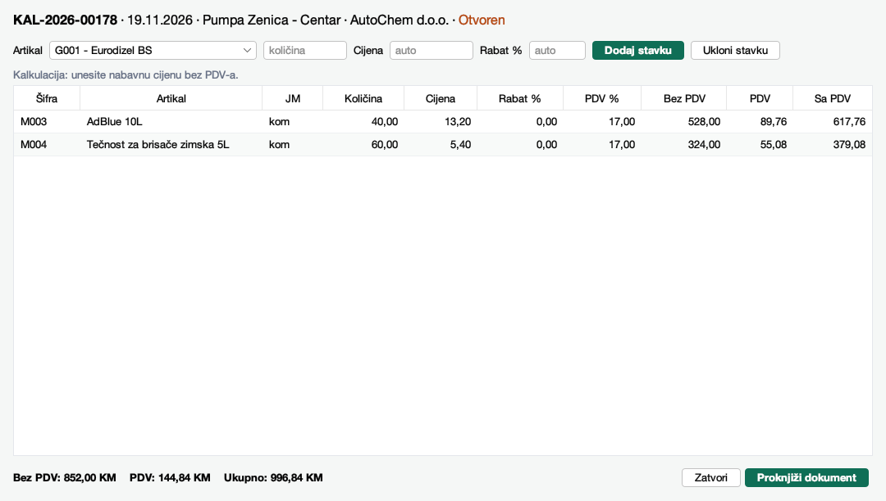
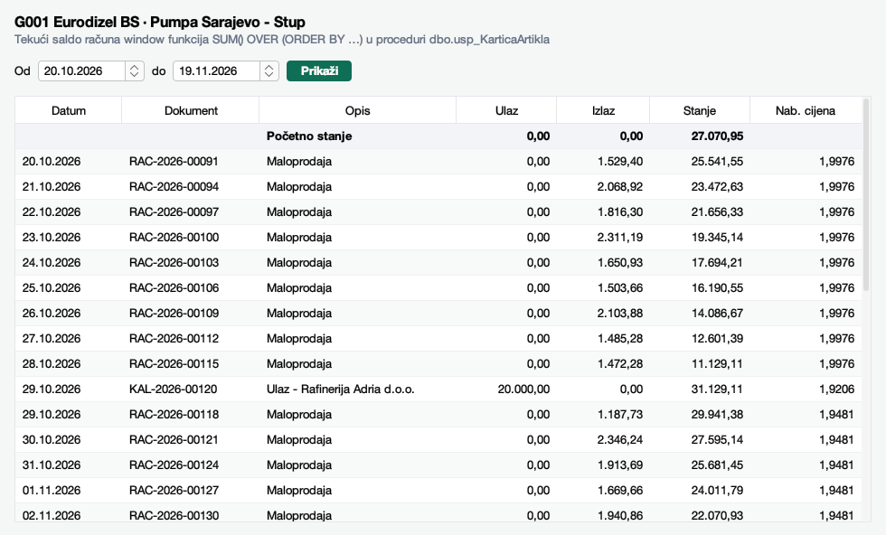

# StanicaERP

Desktop aplikacija za mrežu benzinskih pumpi s veleprodajnim skladištem: artikli, zalihe, kalkulacije, maloprodajni računi, veleprodajne fakture, nivelacija cijena i izvještaji.

**Stack:** Microsoft SQL Server 2022 (T-SQL) · Java 17 · Swing (FlatLaf) · JDBC · OpenPDF · Maven · Git



## Ideja

Poslovna logika je u bazi, a ne u aplikaciji. Knjiženje dokumenta, provjera zaliha, prosječna nabavna cijena, numeracija dokumenata i zaštita proknjiženih podataka su u stored procedurama i triggerima. Desktop klijent samo prikazuje podatke i poziva procedure. Zato bi web aplikacija ili kasa koja se sutra spoji na istu bazu dobila ista pravila.

```
 Swing ekrani (ui/)  ──►  Repo (db/)  ──JDBC──►  SQL Server
   forme, tabele,         parametrizovani          view-ovi      (čitanje)
   PDF, štampa            upiti i CallableStmt     procedure     (svaka izmjena)
                                                   triggeri      (zaštita, revizija)
```

## Baza (`database/`)

| Fajl | Sadržaj |
|---|---|
| `01_schema.sql` | 11 tabela, PK/FK, `CHECK` ograničenja (zaliha nikad u minus), filtrirani jedinstveni indeks za JIB, indeksi za karticu i izvještaje, `Croatian_CI_AS` collation |
| `02_views_triggers.sql` | `vw_StavkaIznos` (osnovica, PDV, nabavna vrijednost po stavci), `vw_LagerStanje`, `vw_DokumentPregled`; triggeri za zaključavanje proknjiženih dokumenata i historiju cijena |
| `03_procedures.sql` | 10 procedura (lista ispod) |
| `04_seed.sql` | simulacija 60 dana poslovanja kroz iste procedure: oko 400 dokumenata, 3 pumpe + veleprodaja, promjene cijena goriva |

**Procedure**

- `usp_Dokument_Kreiraj`: novi dokument i broj `KAL-2026-00001` bez duplikata pri istovremenom radu (`UPDLOCK, HOLDLOCK`)
- `usp_Stavka_Dodaj`: sama povuče MPC (račun), VPC = prosječna nabavna + marža (faktura) i ugovoreni rabat kupca
- `usp_Dokument_Proknjizi`: jedna transakcija (`XACT_ABORT`, `TRY/CATCH`). Ulaz preračunava ponderisanu prosječnu nabavnu cijenu (`MERGE`). Izlaz provjerava zalihu za sve stavke odjednom i vraća jasnu poruku (`STRING_AGG` + `THROW`), pamti nabavnu cijenu za RUC, piše karticu i skida lager
- `usp_Nivelacija`: nova MPC na jednoj ili svim pumpama, s dokumentom NIV po pumpi i obračunom razlike u vrijednosti zaliha
- `usp_KarticaArtikla`: kartica sa tekućim saldom (`SUM() OVER (ORDER BY … ROWS UNBOUNDED PRECEDING)`)
- `usp_Izvjestaj_Prodaja`: prodaja i RUC po artiklu, red UKUPNO preko `GROUPING SETS`, `OPTION (RECOMPILE)` za opcioni filter
- `usp_Pregled`: dashboard sa tri result seta; dani bez prometa preko `GENERATE_SERIES` (SQL Server 2022)
- `usp_Artikal_Sacuvaj`, `usp_Stavka_Obrisi`, `usp_Dokument_Obrisi`

**Triggeri**

- `trg_DokumentStavka_Zakljucano`: stavke proknjiženog dokumenta se ne mogu mijenjati
- `trg_Dokument_Zastita`: proknjižen dokument se ne može obrisati ni vratiti u "otvoren"
- `trg_Cijena_Historija`: svaka promjena MPC ide u revizijsku tabelu (ko, kada, stara i nova cijena)

Svi triggeri su set-based, pa rade ispravno i kad jedan `UPDATE` dira više redova.

## Aplikacija (`src/main/java/ba/stanica/erp/`)

| Ekran | Šta pokazuje |
|---|---|
| Pregled | KPI, grafikon prometa za 30 dana (Java2D), lista za naručivanje |
| Artikli | pretraga, unos i izmjena, validacija u proceduri |
| Lager | stanje po objektu, crveno ispod minimuma, kartica artikla |
| Dokumenti | lista, stavke, novi dokument, knjiženje, PDF dokumenta |
| Nivelacija cijena | promjena MPC na svim pumpama, historija iz triggera |
| Izvještaji | prodaja s RUC-om, izvoz u PDF, štampa |

Tehničke odluke:
- **`Repo`** je jedino mjesto sa SQL-om. Sve vrijednosti idu kao parametri (`PreparedStatement`/`CallableStatement`), pa nema SQL injection-a.
- **`SwingWorker`** (`Ui.async`): svaki upit radi u pozadinskoj niti, pa prozor nikad ne zamrzne.
- **Greške iz baze** (`THROW 50xxx`) prikazuju se korisniku doslovno. Poruku piše onaj ko piše pravilo.

## Pokretanje

Treba: Docker Desktop, Java 17+, Maven.

```bash
./scripts/db-start.sh     # SQL Server 2022 u Dockeru (2 GB RAM, 2 CPU)
./scripts/db-init.sh      # šema + procedure + testni podaci (svaki put iz nule)
./scripts/run.sh          # build + pokretanje aplikacije
./scripts/db-stop.sh      # gasi SQL Server i Docker
```

Konekcija je u `src/main/resources/db.properties` (ili env `STANICA_DB_URL`, `STANICA_DB_USER`, `STANICA_DB_PASSWORD`). Lozinka je lokalna, samo za Docker kontejner.

## Ekrani

| | |
|---|---|
|  |  |
|  |  |
|  |  |

## Šta bih dodao sljedeće

- Storniranje proknjiženog dokumenta (protu-dokument umjesto brisanja)
- Korisnici i prava (ko smije knjižiti, ko mijenjati cijene) preko SQL Server rola
- Akcize i putarine na gorivo u kalkulaciji
- tSQLt testovi za procedure
- Web ili REST sloj (Spring Boot) nad istim procedurama
